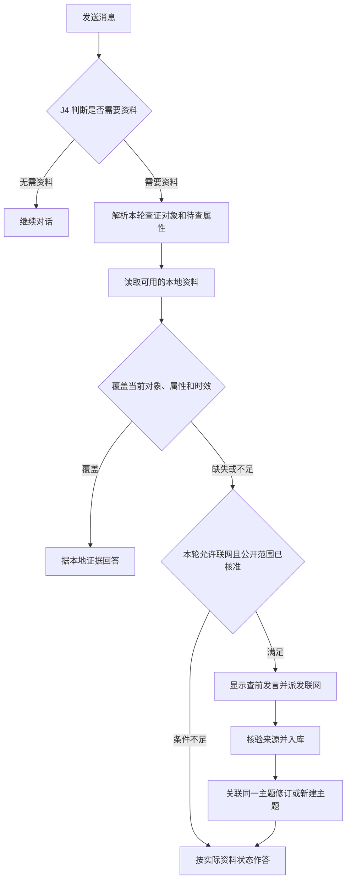

# PCAR 普通发送与本地优先查证施工规划

## 目标

工作台统一通过「发送」受理消息。J4 只判断是否需要取材。闲聊、分享和单凭当前消息就能完成的任务走直接回复。事实核对、回忆资料和用户主动提出的查找均进入取材，本地命中足以回答才直接交给正文。资料缺失、过时或未覆盖请求时，再依会话授权发起联网，随后完成来源核验、资料合并、修订和回复。

## 已核对的偏差

1. 人工审阅会话里，普通发送的最新受理样本已经得到 J4 的 `retrieve`，专职模型也定位了检索对象。该会话当时只有全流程授权，单独的公开查证授权未开启，公开工具派发为零。窗口仍显示旧的「联网查找」按钮，因此按钮容易被当成必经入口。
2. 已审批的公开补查范围可以用旧公开主题和本轮属性构造查询。对没有既有来源的新主题，全部来自当前消息的模型选段缺少对应授权，只能沿用旧的手动选段入口。
3. 普通发送的取材链先查本地，但旧实现有按刷新措辞直接略过本地候选的分支。问新进展时，应该核对本地证据的来源、适用范围、有效期和所需截止时点，再决定是否需要外查。

## 施工顺序

| 工序 | 实现 | 验收证据 |
| --- | --- | --- |
| 1. 统一发送入口 | 删除工作台发送区的联网按钮和选段派发参数。普通发送、引用、输入缓冲及长文沿用同一受理路径。兼容桥仍可处理旧客户端请求及核对已记录的选段。 | 桌面与窄窗口均无联网发送按钮，普通发送不带手动检索标记，长文及历史回执仍可用。 |
| 2. 保留模型的取材判断 | 继续使用已审 J4 的 `retrieve` 和 `none`。`retrieve` 进入同一条本地优先链，专职解析沿用已审逐字引文合同。目标无法可靠定位时结束该回合的查证，回复用实际结算状态。 | 对照 J4 决策回执和解析回执。用户主动要求查找时，应进入取材；普通闲聊应呈现正常回复且无外查。 |
| 3. 判定本地证据够不够 | 以当前对象、当前所问属性和时效为准读取本地材料。J5 核对来源能否回答整个问题。仅有同主题标题、另一版本、过期状态、零散片段或撤回来源时，按不足处理。刷新措辞作为时效检查依据，普通发送仍先检查本地。 | 完整有效的本地命中直接进入正文，联网派发为零。证据过期、属性缺失和撤回样本进入对应不足分支。 |
| 4. 在授权内自动联网 | 将新主题和既有主题补查纳入同一个会话级授权入口。新主题的对外查询限于专职模型从当前用户消息选出的公开对象、属性及时效。既有主题的补查继续核对已获准来源和会话归属。主授权及公开授权有效、本轮允许外查且确有资料缺口时，先显示查前发言，再派发工具。 | 新会话无按钮也能从普通发送发起首次查询。发布前复核许可、选段和查前呈现。明确只用本地、关闭公开范围或无需查找时，原生搜索、独立搜索、网页读取均为零。 |
| 5. 入库、合并与交付 | 工具返回后，按本轮对象、版本、时点和属性核验来源，交给正文的片段须有绑定回执。同主题增量沿用原主题修订链，同网址同内容复用来源文档。换题时建立新的主题归属。没有新依据的检查留下工具回执，正文按实际结果回复。 | 比较查询、来源文档、主题标识、父修订和正文绑定。已知事实、未证实说法和本轮没有查到的内容保持各自状态。 |

工序 1 至 4 的入口和路由已在开发版按上述方向调整。工序 5 沿用已经跑通的 v4 取材与修订机制。新增的会话授权覆盖当前消息的公开查询片段，旧的语境补查授权可继续用于原范围，用户可在同一授权面板开启新范围。轮到实际外查时无需另点发送区的按钮。

作者批准后，验收角色的原人工审阅会话已切到修复版隔离窗口，已有四轮对话均可读取。普通发送中的公开网址从新回合起也使用同一会话级查证授权，保留旧回执的读回合同。隔离窗口已核对发送入口和授权状态，作者可继续使用原会话。

## 验收矩阵

| 人工标注场景 | 必须观察到的链路 |
| --- | --- |
| 主动问一个公开新主题，本地无相关资料 | J4 进入取材，解析采用当前用户原话，本地不足后进入已授权的联网流程。 |
| 主动查证，但本地已有足以回答的有效来源 | J4 进入取材，本地命中后直接回答，无新增公开联网派发。 |
| 主动问最新进展，已有材料落在不合用的版本或时点 | 本地不足，以相同对象和时效需求发起获准的联网，不把历史说法当作当前结论。 |
| 明确只用本地资料，或明确拒绝新增联网 | 本地可用就引用，本地不足就据实说明，公开工具为零。 |
| 普通交流、提到曾经查过的事，或尚未发出的草稿 | 本轮不启动公开工具。 |
| 同一公开主题追加属性，再明确换题 | 增量进入原主题修订，新主题使用自身的对象和来源。 |
| 没有公开授权，或对象、属性仍无法确定 | 暂无外查结果时沿实际状态交付，普通自动流程不弹出逐轮联网确认框。 |
| 断网、回复呈现中断、重开原窗口 | 依相同回合及原回执对账，已派发或效果未知的位置不重复发送。 |

工程验收按实际回合统计。分别记录「主动取材意图被识别」「该在本地回答」「已授权且应外查」「不应外查」「来源与修订归属」等人工标注和真实回执。对该外查的样本，查看 J4、目标绑定、本地判定、工具回执和最终显示的回复。对不该外查的样本，核对三个公开工具均无派发。回执未知的样本照实登记。作者完成换题对话后，以实际标注核对工程通过率。
